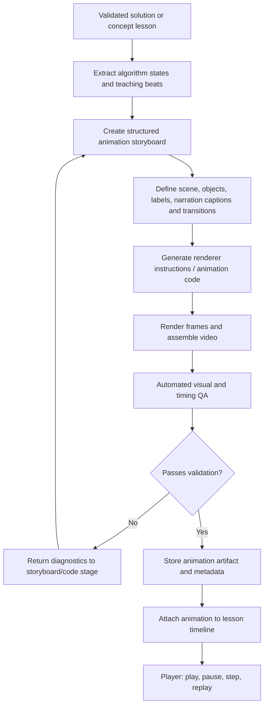

# Didactics — Personalized LeetCode Tutor

Didactics turns a LeetCode problem number into a personalized, visual learning session. The learner enters a question number, reviews the canonical problem, configures their programming language and two separate proficiency levels, and chooses whether to learn the solution or the prerequisites.

The MVP is one focused journey:

1. Enter a LeetCode problem number.
2. Retrieve and display the canonical problem details.
3. Choose a coding language: **Java, Python, C, or C++**.
4. Set **DSA proficiency** and **programming-language proficiency** independently.
5. Choose **Solve this problem** or **Teach me the prerequisites**.
6. Learn through a tailored explanation, language-specific code, and an automatically generated algorithm animation.

---

## Core learner journey


## Learner configuration

Language and proficiency are explicit request inputs, not hidden assumptions.

| Setting | Choices | How Didactics uses it |
|---|---|---|
| Programming language | Java, Python, C, C++ | Generates idiomatic code, syntax, examples, and animation labels in the selected language |
| DSA proficiency | Beginner, Intermediate, Advanced | Controls depth of data-structure and algorithm explanations |
| Programming proficiency | Beginner, Intermediate, Advanced | Controls how much language syntax and programming fundamentals are explained |

The two proficiency levels must remain independent. A learner may know Java syntax well but be new to DSA, or understand algorithms but be new to C++.

**Beginner programming proficiency** triggers explicit syntax teaching alongside the code: variable declarations, types, loops, conditionals, functions/methods, collections/arrays, references/pointers where relevant, standard-library calls, and language-specific conventions. Explain the syntax used in the actual solution, not an unrelated full-language tutorial. Intermediate learners receive explanations of non-obvious constructs and APIs. Advanced learners receive concise idiomatic code and focus on algorithmic trade-offs.

## The two learning paths

### A. Solve this problem

- Restate the task and identify inputs, outputs, and constraints.
- Explain intuition and key observations at the selected DSA level.
- Compare brute force and optimized approaches where useful.
- Derive the chosen algorithm step by step.
- Generate code in the selected language.
- Adapt syntax detail to programming proficiency.
- Walk through a sample input and edge cases.
- Explain correctness and time/space complexity.
- Generate an animation storyboard and visual trace for the algorithm.

### B. Teach me the prerequisites

- Identify the concepts required for this particular problem.
- Build a dependency graph and order concepts from foundational to advanced.
- Explain why each concept matters to the target question.
- Teach each concept at the selected DSA level.
- Include standalone examples and quick knowledge checks.
- Explain language syntax used in prerequisite examples according to programming proficiency.
- Generate small concept animations when visualizing a concept is genuinely useful.
- End with a bridge back to the target problem without revealing the full solution by default.

## Animation generation pipeline

Animation is a first-class part of the product—not a decorative afterthought. The teaching generator produces a structured, deterministic storyboard before any renderer is called.



Animation requirements:
- Use the same algorithm trace/state data as the written explanation and code walkthrough.
- Show meaningful states: arrays, pointers, indices, hash maps, stacks/queues, trees/graphs, recursion frames, or other relevant structures.
- Make each state transition understandable, with highlights, labels, and a short caption.
- Use language-agnostic algorithm state for rendering; code snippets remain language-specific.
- Generate scenes from a typed storyboard schema, not arbitrary unconstrained model code.
- Validate storyboard references and state transitions before rendering.
- Run rendering in an isolated worker with resource/time limits.
- Check output dimensions, duration, frame count, empty/corrupt output, and basic visual consistency.
- Support deterministic re-rendering from a saved storyboard.
- If rendering fails, preserve the lesson and show the textual walkthrough; never block learning on animation availability.

The first implementation can use Manim for programmatic mathematical/algorithmic scenes. Keep the renderer behind an adapter so another renderer can be added later. TTS/narration can be a later enhancement; MVP captions and on-screen explanations are sufficient.

## Architecture

| Layer | Responsibility |
|---|---|
| Client | Problem entry, details review, language/proficiency settings, path selection, lesson and animation player |
| Problem API | Validate number and retrieve canonical LeetCode metadata |
| Learner profile/config | Validate language, DSA level, and programming level |
| Learning orchestrator | Route exactly one selected learning path |
| Solution teaching generator | Approach, proof, complexity, trace, code |
| Prerequisite curriculum generator | Concept dependencies, ordered lessons, examples and checks |
| Code explainer | Language-specific syntax annotations controlled by programming proficiency |
| Animation planner | Convert validated lesson/trace into storyboard schema |
| Animation renderer | Render storyboard to video and produce metadata |
| QA/Artifact service | Validate render, retain diagnostics, expose playable artifact |
| Cache/storage | Cache problem details and store storyboard/render artifacts |

## API contracts

### Retrieve problem

`GET /api/problems/{number}`

Returns canonical source data: number, title, difficulty, statement, examples, constraints, tags, URL and provenance.

### Generate learning session

`POST /api/learning-sessions`

Example:

```json
{
  "problem_number": 1,
  "intent": "solve",
  "language": "java",
  "dsa_proficiency": "beginner",
  "programming_proficiency": "beginner",
  "animation": true
}
```

Allowed values:
- `intent`: `solve` | `prerequisites`
- `language`: `java` | `python` | `c` | `cpp`
- `dsa_proficiency`: `beginner` | `intermediate` | `advanced`
- `programming_proficiency`: `beginner` | `intermediate` | `advanced`

### Suggested artifacts

- `ProblemDetails`: canonical problem metadata and provenance.
- `LearnerConfig`: language, DSA proficiency, programming proficiency.
- `SolutionLearningPlan`: explanation, algorithm, proof, complexity, language-specific code, syntax annotations, trace.
- `PrerequisiteLearningPath`: concept dependency graph, ordered lessons, examples, checks, target-problem bridge.
- `AnimationStoryboard`: scenes, states, transitions, highlights, captions, timing, renderer settings.
- `AnimationArtifact`: artifact URI, format, dimensions, duration, frame rate, storyboard version, render status and QA report.
- `LearningSession`: problem, intent, learner config, lesson artifacts and animation status.

## Scope boundaries

Included in the focused MVP: problem-number lookup, problem confirmation, language selection, independent proficiency settings, two learning paths, tailored code/syntax explanations, structured animation storyboards, and a first renderer integration.

Deferred until the core journey works: user accounts and progress analytics, other coding platforms, automatic LeetCode submissions, social features, multi-agent expansion, TTS/voice narration, and arbitrary free-form topic discovery.

## Reliability and safety

- The source adapter—not the LLM—is authoritative for problem facts.
- Do not invent problem statements if lookup fails.
- Validate all learner settings and generated artifacts with strict schemas.
- Treat retrieved problem text as untrusted data.
- Do not execute arbitrary model-generated code; renderer instructions must be constrained to a safe scene schema/templates.
- Render in an isolated, resource-limited worker.
- Keep credentials in environment variables.
- Animation failure must degrade gracefully to the validated text/code lesson.

## Implementation order

1. Problem-number lookup and normalized problem schema.
2. Learner configuration: language + two independent proficiency levels.
3. Problem review UI and two-path selection.
4. Solution and prerequisite outputs with proficiency-aware explanations.
5. Shared algorithm trace and typed storyboard schema.
6. Manim renderer adapter, asynchronous render job, QA and player.
7. End-to-end tests for all languages, proficiency combinations, both paths and render failure.

This README is the product specification and implementation baseline; it does not claim that these features are already implemented in the source code.
