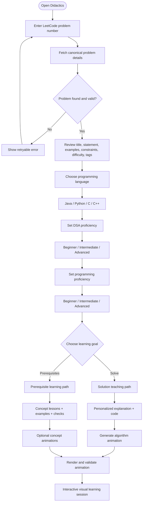
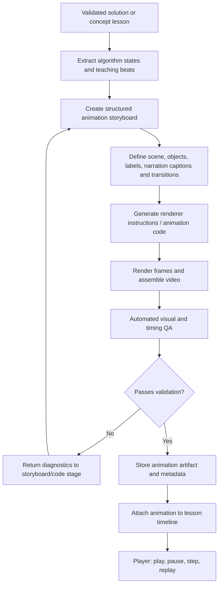

# Didactics — Personalized LeetCode Tutor

Didactics turns a LeetCode problem number into a personalized, visual learning session. The learner enters a question number, reviews the canonical problem, configures their programming language and two separate proficiency levels, and chooses whether to learn the solution or the prerequisites.

The MVP is one focused journey:

1. Enter a LeetCode problem number.
2. Retrieve and display the canonical problem details.
3. Choose a coding language: **Java, Python, C, or C++**.
4. Set **DSA proficiency** and **programming-language proficiency** independently.
5. Choose **Solve this problem** or **Teach me the prerequisites**.
6. Learn through a brute-force-to-optimized solution ladder, per-variant complexity derivations, a scene-by-scene lesson, Manim visuals, synchronized narration and verified playback.

---

## Core learner journey



## Learner configuration

Language and proficiency are explicit request inputs, not hidden assumptions.

| Setting | Choices | How Didactics uses it |
|---|---|---|
| Programming language | Java, Python, C, C++ | Generates idiomatic code, syntax, examples, and animation labels in the selected language |
| DSA proficiency | Beginner, Intermediate, Advanced | Controls depth of data-structure and algorithm explanations |
| Programming proficiency | Beginner, Intermediate, Advanced | Controls how much language syntax and programming fundamentals are explained |

The two proficiency levels must remain independent. A learner may know Java syntax well but be new to DSA, or understand algorithms but be new to C++.

**Beginner programming proficiency** triggers explicit syntax teaching alongside the code: variable declarations, types, loops, conditionals, functions/methods, collections/arrays, references/pointers where relevant, standard-library calls, and language-specific conventions. Explain the syntax used in the actual solution, not an unrelated full-language tutorial. Intermediate learners receive explanations of non-obvious constructs and APIs. Advanced learners receive concise idiomatic code and focus on algorithmic trade-offs.

## The two learning paths

### A. Solve this problem

- Restate the task and identify inputs, outputs, and constraints.
- Explain intuition and key observations at the selected DSA level.
- Start with a correct brute-force baseline, then optimize in explicit stages.
- Present materially different valid algorithms and explain their trade-offs.
- Generate code in the selected language.
- Adapt syntax detail to programming proficiency.
- Walk through a sample input and edge cases.
- Explain correctness and derive time/space complexity for every implementation variant.
- Generate a scene-by-scene storyboard with exact narration and visual instructions.
- Render Manim visuals and per-scene audio, then run synchronized multimodal QA.

### B. Teach me the prerequisites

- Identify the concepts required for this particular problem.
- Build a dependency graph and order concepts from foundational to advanced.
- Explain why each concept matters to the target question.
- Teach each concept at the selected DSA level.
- Include standalone examples and quick knowledge checks.
- Explain language syntax used in prerequisite examples according to programming proficiency.
- Generate small concept animations when visualizing a concept is genuinely useful.
- End with a bridge back to the target problem without revealing the full solution by default.

## Animation generation pipeline

Animation is a first-class part of the product—not a decorative afterthought. The teaching generator produces a structured, deterministic storyboard before any renderer is called.



Animation requirements:
- Use the same algorithm trace/state data as the written explanation and code walkthrough.
- Show meaningful states: arrays, pointers, indices, hash maps, stacks/queues, trees/graphs, recursion frames, or other relevant structures.
- Make each state transition understandable, with highlights, labels, and a short caption.
- Use language-agnostic algorithm state for rendering; code snippets remain language-specific.
- Generate scenes from a typed storyboard schema, not arbitrary unconstrained model code.
- Validate storyboard references and state transitions before rendering.
- Run rendering in an isolated worker with resource/time limits.
- Check output dimensions, duration, frame count, empty/corrupt output, and basic visual consistency.
- Support deterministic re-rendering from a saved storyboard.
- If rendering fails, preserve the lesson and show the textual walkthrough; never block learning on animation availability.

The first implementation can use Manim for programmatic mathematical/algorithmic scenes. Keep the renderer behind an adapter so another renderer can be added later. Narration is part of the target workflow: every scene defines spoken content and timing, and the audio agent generates a matching segment. Captions remain an accessibility fallback.

## Architecture

| Layer | Responsibility |
|---|---|
| Client | Problem entry, details review, language/proficiency settings, path selection, lesson and animation player |
| Problem API | Validate number and retrieve canonical LeetCode metadata |
| Learner profile/config | Validate language, DSA level, and programming level |
| Learning orchestrator | Route exactly one selected learning path |
| Solution teaching generator | Approach, proof, complexity, trace, code |
| Prerequisite curriculum generator | Concept dependencies, ordered lessons, examples and checks |
| Code explainer | Language-specific syntax annotations controlled by programming proficiency |
| Animation planner | Convert validated lesson/trace into storyboard schema |
| Animation renderer | Render storyboard to video and produce metadata |
| QA/Artifact service | Validate render, retain diagnostics, expose playable artifact |
| Cache/storage | Cache problem details and store storyboard/render artifacts |

## API contracts

### Retrieve problem

`GET /api/problems/{number}`

Returns canonical source data: number, title, difficulty, statement, examples, constraints, tags, URL and provenance.

### Generate learning session

`POST /api/learning-sessions`

Example:

```json
{
  "problem_number": 1,
  "intent": "solve",
  "language": "java",
  "dsa_proficiency": "beginner",
  "programming_proficiency": "beginner",
  "animation": true
}
```

Allowed values:
- `intent`: `solve` | `prerequisites`
- `language`: `java` | `python` | `c` | `cpp`
- `dsa_proficiency`: `beginner` | `intermediate` | `advanced`
- `programming_proficiency`: `beginner` | `intermediate` | `advanced`

### Suggested artifacts

- `ProblemDetails`: canonical problem metadata and provenance.
- `LearnerConfig`: language, DSA proficiency, programming proficiency.
- `SolutionLearningPlan`: explanation, algorithm, proof, complexity, language-specific code, syntax annotations, trace.
- `PrerequisiteLearningPath`: concept dependency graph, ordered lessons, examples, checks, target-problem bridge.
- `AnimationStoryboard`: scenes, states, transitions, highlights, captions, timing, renderer settings.
- `AnimationArtifact`: artifact URI, format, dimensions, duration, frame rate, storyboard version, render status and QA report.
- `LearningSession`: problem, intent, learner config, lesson artifacts and animation status.

## Scope boundaries

Included in the focused MVP: problem-number lookup, problem confirmation, language selection, independent proficiency settings, two learning paths, tailored code/syntax explanations, structured animation storyboards, and a first renderer integration.

Deferred until the core journey works: user accounts and progress analytics, other coding platforms, automatic LeetCode submissions, social features, arbitrary free-form topic discovery.

## Reliability and safety

- The source adapter—not the LLM—is authoritative for problem facts.
- Do not invent problem statements if lookup fails.
- Validate all learner settings and generated artifacts with strict schemas.
- Treat retrieved problem text as untrusted data.
- Do not execute arbitrary model-generated code; renderer instructions must be constrained to a safe scene schema/templates.
- Render in an isolated, resource-limited worker.
- Keep credentials in environment variables.
- Animation failure must degrade gracefully to the validated text/code lesson.

## Implementation order

1. Problem-number lookup and normalized problem schema.
2. Learner configuration: language + two independent proficiency levels.
3. Problem review UI and two-path selection.
4. Solution and prerequisite outputs with proficiency-aware explanations.
5. Shared algorithm trace and typed storyboard schema.
6. Manim renderer adapter, asynchronous render job, QA and player.
7. End-to-end tests for all languages, proficiency combinations, both paths and render failure.

This README is the product specification and implementation baseline; it does not claim that these features are already implemented in the source code.

## Six-agent solution-to-video workflow

| Agent | Responsibility | Required output |
|---|---|---|
| **1 — Solution strategist** | Solve in the selected language. Begin with brute force, progressively optimize, and identify materially different valid algorithms. | Ordered approaches, observations, correctness, trade-offs and complete code variants with stable IDs. |
| **2 — Complexity analyst** | Analyze every code variant; derive rather than merely state complexity. | Per-variant time/space derivations, loop/recurrence analysis, auxiliary vs input space, recursion stack and meaningful case distinctions. |
| **3 — Lesson director** | Turn solutions and complexity reports into a teachable video plan. | Scene timeline, durations, objectives, exact narration, on-screen text, visual direction, code/trace references, transitions and audio cues. |
| **4 — Manim animator** | Implement every visual scene from the approved plan. | Manim scene code, reusable components, render settings and scene mapping. |
| **5 — Audio producer** | Generate narration from the exact approved scene scripts. | One audio segment per scene, actual duration, voice/config metadata, sample rate, encoding and offsets. |
| **6 — Multimodal QA director** | Watch the video and listen to the audio; compare them with the plan, code and complexity reports. | Per-scene verdicts, timestamps, evidence and actionable repair tickets. |

### Orchestration and repair loop

~~~mermaid
flowchart TD
    P[Problem + language] --> A1[Agent 1: solution portfolio]
    A1 --> G1{Approaches valid and complete?}
    G1 -->|No| A1R[Repair solution portfolio] --> A1
    G1 -->|Yes| A2[Agent 2: complexity per code variant]
    A2 --> G2{All variants have derivations?}
    G2 -->|No| A2R[Repair derivations] --> A2
    G2 -->|Yes| A3[Agent 3: scene plan + narration]
    A3 --> G3{Plan complete?}
    G3 -->|No| A3R[Revise plan] --> A3
    G3 -->|Yes| PAR[Agents 4 and 5 work in parallel]
    PAR --> A4[Agent 4: Manim visuals]
    PAR --> A5[Agent 5: scene audio]
    A4 --> COMP[Compose video + audio + captions]
    A5 --> COMP
    COMP --> A6[Agent 6: watch and listen]
    A6 --> PASS{All QA gates pass?}
    PASS -->|Yes| DONE[Publish verified lesson]
    PASS -->|No| BUDGET{Retry budget remains?}
    BUDGET -->|No| HOLD[Needs review; retain text lesson]
    BUDGET -->|Yes| TICKETS[Scene-specific repair tickets]
    TICKETS -->|Visual / Manim| A4
    TICKETS -->|Audio / narration| A5
    TICKETS -->|Timing / synchronization| A4
    A4 --> COMP
    A5 --> COMP
~~~

Agent 6 is the release gate. Each ticket identifies the scene, timestamp, observed defect, expected behavior and acceptance test. Route visual defects to Agent 4, audio defects to Agent 5, and synchronization defects to the responsible media agents. Reopen Agent 3 only if the plan itself is incomplete or contradictory. Use a finite retry budget (default target: three repair cycles); never loop indefinitely or publish failed output as verified.

### Complexity explanation standard

For every approach and language-specific implementation, Agent 2 identifies input-size variables, dominant operations, loop bounds or recurrences, operation-count simplification, allocated structures, recursion stack and auxiliary-vs-input space. Explain best/average/worst cases when meaningful and state assumptions such as expected hash lookup time. Every code variant maps to its own complexity record.

### Scene and media contracts

Every scene has a stable ID, order, target duration, learning objective, exact spoken script, on-screen text, visual direction, code/trace/complexity references, transition and audio-segment ID. Agent 4 maps visual beats to Manim scenes. Agent 5 generates matching audio and returns actual duration. Composition aligns audio to scene boundaries and records offsets; it must not silently truncate narration.

### Agent 6 release checklist

- Every valid approach, including a meaningful brute-force baseline, is represented.
- Every code variant has a matching complexity derivation.
- Scene order covers all required explanations and follows the learning progression.
- Code, trace, complexity, captions and spoken narration agree.
- No missing scenes, blank frames, clipping, overlaps or unreadable labels.
- Narration is complete, intelligible and synchronized with the intended scene.
- Video/audio decode end-to-end with valid durations, frame/sample rates and offsets.
- A manifest links exact solution, complexity, plan, render, audio and QA versions.

The backend now implements all six agent stages, Gemini-first/Groq-fallback model calls, strict structured-output validation, parallel Manim/audio production, per-stage checkpoints, persistent logs, and a bounded three-cycle media QA repair loop. Media generation requires local Manim, FFmpeg and TTS dependencies. Agent 6 performs sampled-frame inspection, media probing and Groq Whisper transcript checks when configured; treat its result as automated technical QA, not a substitute for human review.


## Run the six-agent workflow

Configure backend/.env from backend/.env.example with GEMINI_API_KEY and GROQ_API_KEY, then follow [docs/RUNNING.md](docs/RUNNING.md) for Python, Manim, FFmpeg and frontend setup. Generated run artifacts and checkpoints are saved under out/ and are excluded from Git.


## Modular agent implementation

Each agent implementation lives in its own module under `backend/app/agents/`. Its instructions live in `backend/app/prompts/agent_<n>_*.txt` and are loaded by the shared prompt loader. Agent 1's problem payload is intentionally restricted to **statement, examples, and constraints**; learner language and proficiency are passed as a separate, small configuration object. It does not receive title, difficulty, tags, URLs, source metadata, or unrelated fields.

Workflow persistence is separated from orchestration: `backend/app/storage/out_manager.py` owns run directories and JSON artifacts, while `checkpoint_manager.py` owns checkpoint and failure records. The Pydantic workflow schemas are strict, bounded, and validate IDs and cross-agent references. See [Agent structure](docs/AGENT_STRUCTURE.md).
