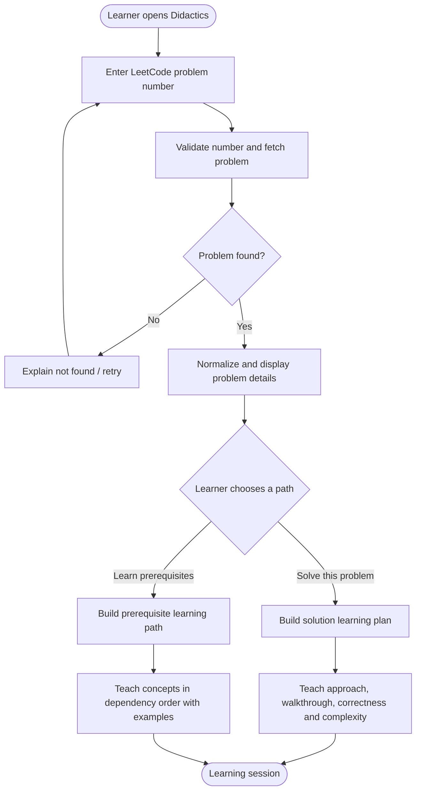

# Didactics — LeetCode Learning Agent

Didactics helps a learner understand a LeetCode problem from its **problem number**. The first milestone deliberately focuses on one complete learning journey rather than a broad, multi-purpose content-generation platform.

A learner enters a LeetCode question number. Didactics retrieves and normalizes the problem details, presents them for confirmation, and then asks what kind of help the learner wants:

1. **Solve the problem** — understand the problem, reason toward an approach, inspect an algorithm walkthrough, and learn complexity and implementation details.
2. **Learn the prerequisites** — build the concepts and data-structure/algorithm foundations needed to solve the problem, in a sensible order, before attempting the solution.

The product is designed to be extended later. The current milestone should be small, reliable, testable, and useful end-to-end.

---

## MVP user journey



## Scope

### Included in this milestone

- Accept a LeetCode question number as the primary input.
- Validate the input and retrieve the matching problem.
- Show the canonical title, problem number, difficulty, description, examples, constraints, and topic tags when available from the source.
- Preserve source attribution and distinguish fetched facts from AI-generated teaching content.
- Ask the learner to select one of two explicit learning intents.
- Generate a solution-oriented learning experience or a prerequisite-first learning experience.
- Use structured, schema-validated outputs rather than relying on free-form model responses.
- Handle invalid numbers, missing problems, unavailable sources, rate limits, and model failures clearly.
- Keep provider/model selection configurable and keep tests deterministic with mocked external services.

### Explicitly deferred

- Arbitrary natural-language topic exploration.
- Multi-platform coding problem ingestion.
- User profiles, streaks, social features, leaderboards, and progress analytics.
- Automatic code submission to LeetCode.
- Video/Manim generation, narration, TTS, subtitles, and media rendering.
- Multiple specialized agents without a demonstrated need.
- Broad web research unrelated to the selected problem.

## Product behavior

### 1. Problem lookup

The user enters an integer problem number, for example `1`. The application validates the format, calls a problem-source adapter, and returns a normalized `ProblemDetails` object.

The lookup layer must not invent problem details. It should retain canonical source identifiers/URLs and report when a field is unavailable. If the upstream source cannot be reached, show a recoverable error rather than fabricating a response.

### 2. Problem confirmation

Before spending tokens on teaching, display the problem summary:

- Number and title
- Difficulty
- Statement
- Examples and explanations
- Constraints
- Topic tags
- Canonical LeetCode URL

Allow the user to go back and enter another number.

### 3. Learning-path selection

Present two clear choices:

**Solve this problem**
- Restate the task and identify inputs/outputs.
- Explain key observations and constraints.
- Derive an appropriate approach, from intuition to optimized solution.
- Walk through an example step by step.
- Explain correctness intuition/proof.
- Explain time and space complexity.
- Provide implementation in the selected language (language selection can default to a configured value in this MVP).

**Teach me the prerequisites**
- Identify the concepts actually needed for this problem.
- Build a dependency-aware sequence from foundational to advanced concepts.
- Explain why each concept is needed for this problem.
- Teach each concept with a small independent example.
- Include a quick knowledge check or practice prompt per concept.
- End with a bridge that connects the prerequisites back to the target problem.
- Do not reveal the complete solution unless the learner explicitly switches paths.

## Architecture

| Layer | Responsibility | Initial implementation direction |
|---|---|---|
| Client | Number input, problem summary, path selection, learning experience | Keep the current UI approach where reusable; avoid redesigning for deferred features |
| API | Validate requests and expose lookup/learning endpoints | FastAPI |
| Problem data | Fetch and normalize canonical LeetCode problem metadata | Pluggable problem-source adapter; cache successful lookups |
| Orchestration | Route the selected learning intent | Small explicit workflow; LangGraph only where it materially helps |
| Teaching | Generate solution plan or prerequisite path | Existing provider abstraction and structured LLM outputs |
| Validation | Validate IDs, schemas, required fields, and output consistency | Deterministic Python + Pydantic |
| Storage/cache | Cache problem metadata and optionally session artifacts | Defer persistent DB until session requirements justify it |

### Important boundary

The problem-source adapter is the authority for the question's canonical facts. The language model is responsible for explaining and teaching those facts. The model must not be asked to reconstruct a problem statement from its number when the source lookup fails.

## Proposed API contract

| Method | Endpoint | Purpose |
|---|---|---|
| `GET` | `/health` | Service health |
| `GET` | `/api/problems/{number}` | Fetch normalized problem details |
| `POST` | `/api/learning-paths` | Generate selected learning path |

Example learning-path request:

```json
{
  "problem_number": 1,
  "intent": "solve",
  "language": "java",
  "learner_level": "beginner"
}
```

`intent` is either `solve` or `prerequisites`. The prerequisites path must not silently return a solution walkthrough.

## Suggested structured artifacts

- `ProblemDetails`: number, slug, title, difficulty, statement, examples, constraints, topic tags, canonical URL, source metadata.
- `LearningPathRequest`: problem number, selected intent, optional language, learner level.
- `SolutionLearningPlan`: task model, observations, approach steps, trace, correctness rationale, complexity, implementation outline.
- `PrerequisiteLearningPath`: ordered concepts, dependencies, reason each concept matters, explanations, examples, checks, target-problem bridge.
- `LearningSession`: problem reference, chosen intent, generated artifact, provider/model metadata, timestamps, and status.

Use strict validation and explicit enums. Avoid returning raw hidden model reasoning; return concise, observable explanations and educational rationale.

## Reliability and quality requirements

- A valid number must map to the correct problem or return an explicit not-found/unavailable outcome.
- Problem metadata must be traceable to the source.
- Never fabricate a problem statement, constraints, examples, or tags.
- All generated artifacts must validate against their schemas before reaching the UI.
- Prerequisite concepts must be relevant to the selected problem and ordered by dependency.
- The solve and prerequisite paths must be behaviorally distinct.
- External services must be wrapped behind adapters so they can be mocked in tests.
- Keep provider credentials in environment variables; never commit secrets.
- Add bounded timeouts/retries for external requests and clear user-facing errors.
- Cache by canonical problem identity and source version where possible.

## Repository status and implementation plan

This README describes the **new focused product direction**, not a claim that every listed endpoint and feature is already implemented. The current source tree is preserved on `archive/current-project-2026-11`. The `main` branch is now the focused product specification and architecture baseline.

Recommended implementation order:

1. Problem-number validation and canonical problem lookup adapter.
2. `ProblemDetails` schema and lookup endpoint with deterministic tests.
3. Problem confirmation UI.
4. Two-option learning-path selection.
5. Solution-plan generator with schema validation.
6. Prerequisite-path generator with dependency ordering and schema validation.
7. End-to-end tests covering both paths and upstream failures.

## Development principles

- Ship one complete journey before adding more domains.
- Prefer deterministic code for fetching, parsing, validation, and caching.
- Use an LLM only for pedagogical reasoning and explanations.
- Keep agents small and output contracts explicit.
- Build against mocked source/model responses first; reserve live API tests for opt-in integration checks.
- Do not add Manim, TTS, video rendering, databases, or multi-agent complexity to this milestone.
