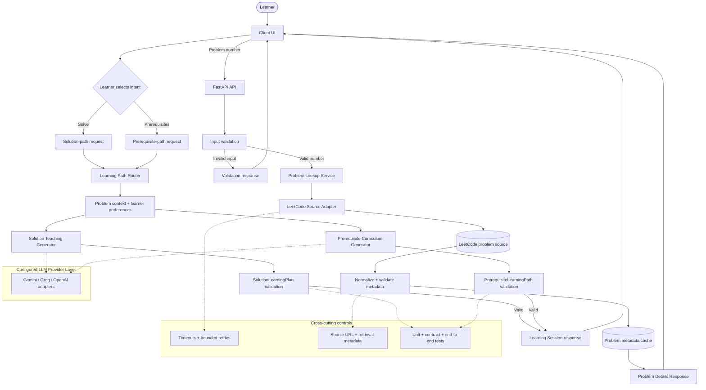
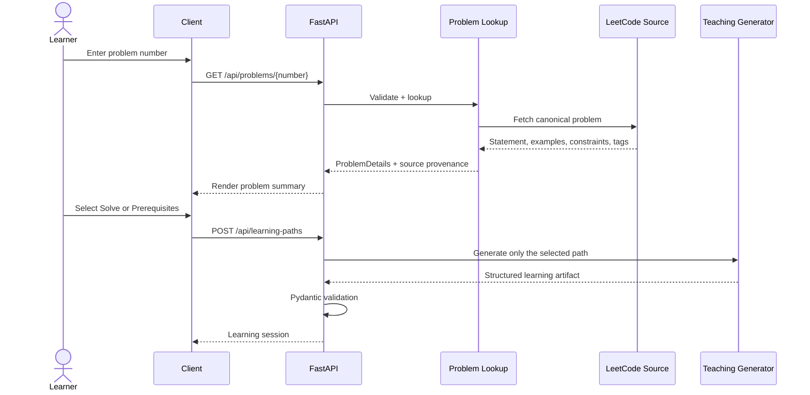
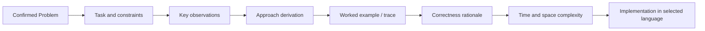
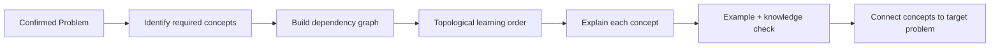

# Didactics — Focused MVP Architecture

## Product boundary

The first milestone supports one entry point: a **LeetCode problem number**. It looks up the canonical problem, displays the retrieved details, and lets the learner select one of two paths: solve the problem or learn its prerequisites.

## Request sequence

## Responsibilities

| Component | Responsibility | Must not do |
|---|---|---|
| Client | Collect number, show fetched problem, collect intent | Guess metadata |
| Problem Lookup Service | Validate number, call adapter, normalize source fields | Ask an LLM to invent question content |
| LeetCode Source Adapter | Encapsulate upstream request and source-specific parsing | Contain teaching prompts |
| Learning Path Router | Route to exactly one selected learning mode | Run both modes by default |
| Solution Teaching Generator | Explain strategy, trace, correctness, complexity, implementation | Change canonical problem facts |
| Prerequisite Curriculum Generator | Identify and teach relevant concepts in dependency order | Reveal full solution by default |
| Schema Validators | Reject incomplete or malformed artifacts | Silently coerce invalid content |
| Cache | Reuse source metadata safely | Serve stale/unattributed problem details |

## Learning path contracts

### Solve path

### Prerequisites path

## Error handling

- Invalid number: return a validation error and keep the number field editable.
- Problem not found: return a not-found result; do not call the teaching model.
- Source unavailable/rate-limited: return a retriable upstream error; do not fabricate a problem.
- Missing optional metadata: label it unavailable and continue only if required problem context exists.
- LLM timeout/provider failure: return a recoverable generation error and preserve the confirmed problem.
- Invalid generated schema: reject it; allow bounded repair/retry, then surface a clear error.
- Unknown/unsupported intent: reject it rather than selecting a mode implicitly.

## Scope guard

The following are intentionally outside the first milestone: generic topic prompting, multi-platform ingestion, Manim/video/TTS generation, autonomous code submission, progress dashboards, social features, and a large multi-agent graph. Add these only after the problem-number-to-learning-path journey works reliably end to end.
