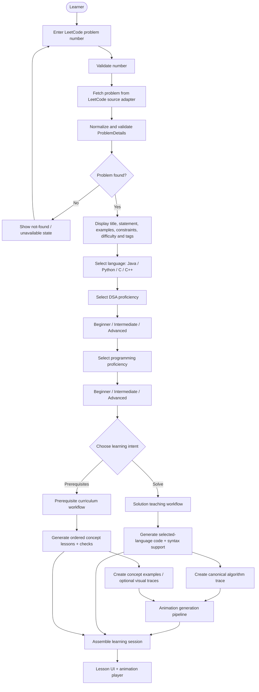
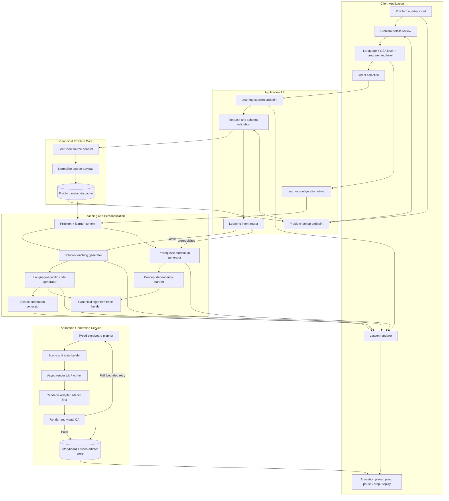
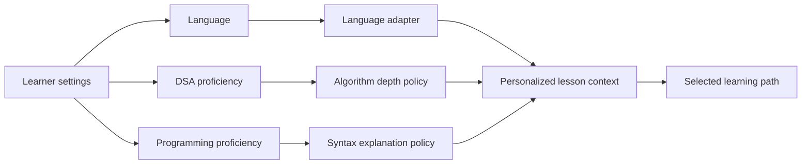
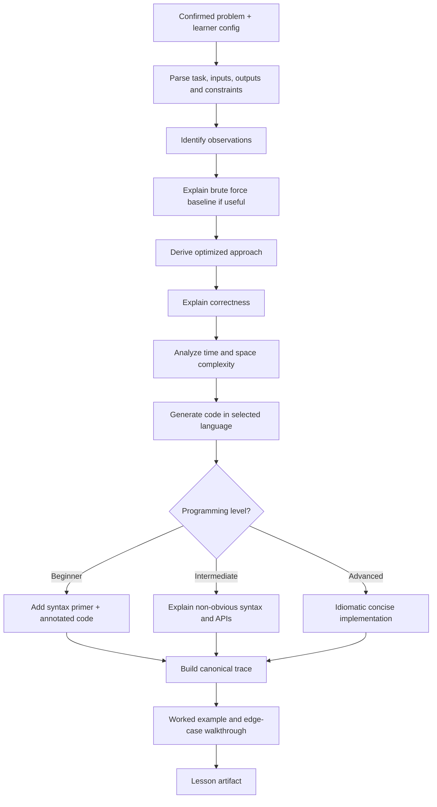
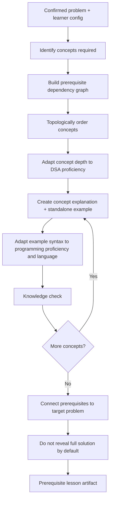
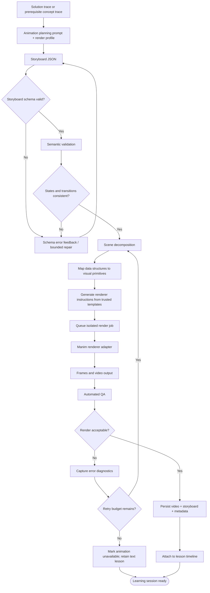
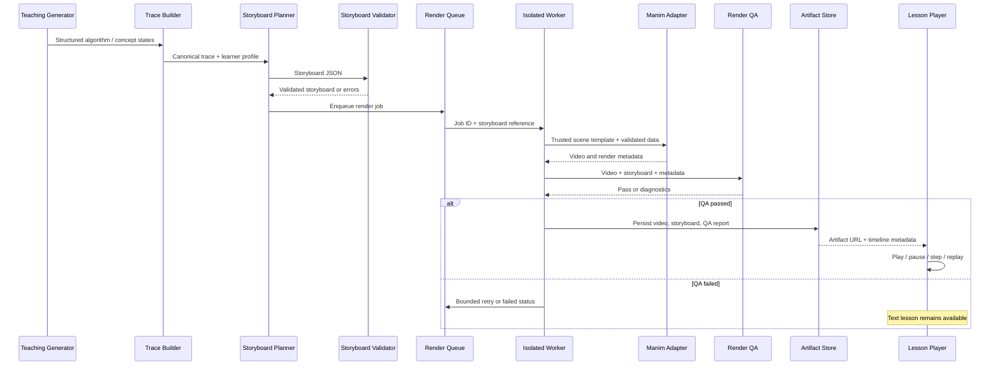

# Didactics — System, Learning and Animation Architecture

## 1. Product overview

Didactics accepts a LeetCode problem number, retrieves the canonical problem, and asks the learner to configure:
- Programming language: **Java, Python, C, C++**
- DSA proficiency: **Beginner, Intermediate, Advanced**
- Programming proficiency: **Beginner, Intermediate, Advanced**

The learner then chooses **Solve this problem** or **Teach me the prerequisites**. Both paths produce level-aware learning content. The solve path also produces language-specific code and a shared algorithm trace. The animation pipeline converts that trace into a storyboard, renders it, validates the output, and attaches it to the learning session.

## 2. End-to-end user journey



## 3. System architecture



## 4. Learner configuration and personalization



| Setting | Values | Output behavior |
|---|---|---|
| Language | Java / Python / C / C++ | All code, syntax notes and language-specific examples use the chosen language |
| DSA proficiency | Beginner / Intermediate / Advanced | Controls prerequisite depth, terminology, derivation detail and complexity discussion |
| Programming proficiency | Beginner / Intermediate / Advanced | Controls explanation of language constructs, syntax and standard-library APIs |

### Programming proficiency policy

- **Beginner:** Explain the actual code line by line where useful. Define syntax used in the solution: declarations, types, assignments, loops, conditionals, methods/functions, arrays/collections, pointers/references, memory concepts and library calls as applicable. Include a small syntax example before the full code when a construct is unfamiliar.
- **Intermediate:** Explain non-obvious syntax, APIs, data representation and language-specific trade-offs. Do not explain basic assignment/loop syntax unless relevant.
- **Advanced:** Provide concise idiomatic code, highlight subtle language behavior and focus on algorithmic decisions/performance.

DSA and programming proficiency are independent axes. Never infer one from the other.

## 5. Learning intent workflows

### 5.1 Solve path



### 5.2 Prerequisite path



## 6. Main animation generation architecture

Animation generation is a separate pipeline consuming validated lesson data and a canonical trace. The LLM may propose a storyboard in a strict schema; deterministic code validates and renders it. Do not let the model submit arbitrary shell commands or unrestricted Python for execution.



### Animation data flow and contracts



### Storyboard schema (conceptual)

Each storyboard should contain:
- `storyboard_version`, `problem_id`, `intent`, `language`, `learner_levels`
- `scenes[]`: scene ID, title, purpose, duration, narration/caption text
- `visual_objects[]`: object ID, type, initial state, labels and style token
- `steps[]`: step index, source trace state, visual changes, highlights, pointer/index changes, caption and duration
- `transitions[]`: from-state, to-state, transition type and duration
- `render_profile`: resolution, frame rate, theme and output format

Use stable object IDs and explicit before/after states. A storyboard step must map to a real trace state. Scene templates render arrays, maps, pointers, trees, graphs, stacks, queues, recursion frames and other structures using typed visual primitives.

### Render quality gates

- Storyboard schema and references are valid.
- State transitions are consistent with the algorithm trace.
- Video file exists, decodes, and has non-zero duration and frames.
- Resolution and frame rate match the render profile.
- Captions fit safe areas and remain readable.
- No missing visual objects, blank scenes or unexpected clipping.
- Render time, memory and output size stay within configured limits.
- Artifact is linked to the exact lesson/trace version used to create it.

## 7. API and data contracts

### Endpoints

| Method | Endpoint | Purpose |
|---|---|---|
| GET | `/health` | Health check |
| GET | `/api/problems/{number}` | Canonical problem lookup |
| POST | `/api/learning-sessions` | Generate selected learning path |
| GET | `/api/learning-sessions/{session_id}` | Session and generation status |
| GET | `/api/animations/{animation_id}` | Animation status and artifact metadata |

Example request:

```json
{
  "problem_number": 1,
  "intent": "solve",
  "language": "cpp",
  "dsa_proficiency": "beginner",
  "programming_proficiency": "beginner",
  "animation": true
}
```

### Core schemas

- `ProblemDetails`: number, slug, title, difficulty, statement, examples, constraints, tags, canonical URL, source metadata.
- `LearnerConfig`: language enum and two independent proficiency enums.
- `LearningSessionRequest`: problem number, intent, learner config, animation preference.
- `SolutionLearningPlan`: observations, approaches, algorithm steps, correctness, complexity, implementation, syntax annotations and trace.
- `PrerequisiteLearningPath`: concept nodes, dependency edges, learning order, examples, checks and target-problem connection.
- `AlgorithmTrace`: ordered states and operations independent of programming language.
- `AnimationStoryboard`: typed scenes, visual objects, steps, transitions, captions and render profile.
- `AnimationArtifact`: ID, status, artifact URI, duration, dimensions, frame rate, storyboard/trace versions and QA report.

## 8. Component responsibilities and guardrails

| Component | Owns | Must not |
|---|---|---|
| Problem source adapter | Canonical question data | Invent missing source facts |
| Learner config | Language and separate proficiency axes | Collapse DSA and coding skill into one level |
| Solution generator | Teaching, approach, code and trace | Ignore selected language or levels |
| Prerequisite generator | Concept dependency curriculum | Reveal full solution by default |
| Syntax explainer | Explain constructs used in selected-language examples | Produce a generic language textbook |
| Trace builder | Deterministic algorithm states | Depend on animation rendering |
| Storyboard planner | Translate trace into visual lesson beats | Execute arbitrary generated code |
| Renderer adapter | Render typed storyboard with trusted templates | Accept arbitrary shell commands |
| QA worker | Validate output and report diagnostics | Mark failed/empty video as successful |
| Lesson UI | Display lesson and play artifact | Block text lesson if video fails |

## 9. Failure handling

- Problem lookup fails: no teaching or animation generation is started.
- Invalid learner configuration: return field-level validation errors.
- Teaching generation fails: retain problem and learner settings for retry.
- Storyboard invalid: bounded schema repair; do not queue invalid jobs.
- Renderer crashes or times out: mark animation failed, preserve lesson, expose retry.
- QA fails: bounded re-render; after retry budget, degrade to text/code.
- Artifact storage fails: retain render diagnostics and do not return a broken playback URL.

## 10. Scope and delivery sequence

1. Problem lookup and canonical problem schema.
2. Learner settings UI/API and independent proficiency handling.
3. Solve and prerequisite workflows.
4. Language-specific code generation and beginner syntax annotation.
5. Canonical trace schema shared by written lesson and animation.
6. Storyboard planner, schema/semantic validation and trusted scene templates.
7. Isolated Manim worker, render queue, QA and player.
8. End-to-end tests for all four languages, both intents, proficiency combinations and animation fallback.

Keep TTS, voice narration, accounts, analytics, other coding platforms and multi-agent expansion deferred until this vertical slice is reliable.

## 11. Six-agent solution, complexity, animation and audio architecture

| Agent | Responsibility | Required artifact |
|---|---|---|
| **1 — Solution strategist** | Start with brute force, derive incremental optimizations, identify distinct valid algorithm families, and provide complete selected-language implementations. | Ordered solution portfolio, correctness, trade-offs and stable code-variant IDs. |
| **2 — Complexity analyst** | Derive runtime and memory for every code variant, including loop/recurrence analysis, auxiliary space, recursion stack and assumptions. | Per-variant complexity report with derivations and meaningful case analysis. |
| **3 — Lesson director** | Design the teaching experience scene by scene. | Scene timeline, durations, objectives, exact narration, on-screen text, visual direction, code/trace/complexity references, transitions and audio cues. |
| **4 — Manim animator** | Implement approved visual scenes with reusable components. | Manim scene sources, render settings, scene mapping and video metadata. |
| **5 — Audio producer** | Generate audio from the exact approved scene scripts. | Per-scene audio, actual duration, transcript identity, voice profile, encoding, sample rate and offsets. |
| **6 — Multimodal QA director** | Watch and listen to the composed media; compare it with the plan and source artifacts. | Per-scene QA verdicts, timestamps, evidence and repair tickets. |

### End-to-end orchestration

~~~mermaid
flowchart TD
    INPUT[Problem + learner settings] --> A1[Agent 1: solution portfolio]
    A1 --> V1{Correct and complete?}
    V1 -->|No| FIX1[Repair portfolio] --> A1
    V1 -->|Yes| A2[Agent 2: complexity per code variant]
    A2 --> V2{Every variant covered?}
    V2 -->|No| FIX2[Repair derivations] --> A2
    V2 -->|Yes| A3[Agent 3: scene plan and narration]
    A3 --> V3{Plan complete?}
    V3 -->|No| FIX3[Revise plan] --> A3
    V3 -->|Yes| PAR[Parallel media production]
    PAR --> A4[Agent 4: Manim visuals]
    PAR --> A5[Agent 5: per-scene audio]
    A4 --> COMP[Compose video, audio, captions and manifest]
    A5 --> COMP
    COMP --> A6[Agent 6: watch and listen]
    A6 --> PASS{All release checks pass?}
    PASS -->|Yes| PUBLISH[Publish verified lesson]
    PASS -->|No| RETRY{Retry budget remains?}
    RETRY -->|No| REVIEW[Needs review; preserve text lesson]
    RETRY -->|Yes| TICKETS[Timestamped repair tickets]
    TICKETS -->|Visual / Manim| A4
    TICKETS -->|Audio / narration| A5
    TICKETS -->|Synchronization| A4
    A4 --> COMP
    A5 --> COMP
~~~

### Agent execution rules

**Agent 1:** Restate task and constraints; show brute force first when meaningful; identify its bottleneck; explain each optimization observation; enumerate genuinely different algorithm families; provide code, correctness and trade-offs for each variant. Cosmetic rewrites are not separate algorithms.

**Agent 2:** Cover every code-variant ID; name input variables and dominant operations; derive bounds from loops, recursion and data-structure costs; distinguish auxiliary memory from input storage; explain Big-O simplification; state meaningful best/average/worst cases and assumptions; flag code/complexity mismatches.

**Agent 3:** Give every scene a stable ID, order, duration, objective, verbatim narration, on-screen copy, visual composition, code/trace/complexity references, transition and audio cue. Make the brute-force-to-optimized progression visible. Never allocate too little time for speech.

**Agent 4:** Implement all planned scenes; use reusable visual components; animate only approved trace states; keep labels, code, pointers and formulas readable; emit scene boundaries and render metadata.

**Agent 5:** Generate one addressable audio segment per scene from the approved script; preserve every word; report actual duration, offsets, transcript identity, voice profile, codec, sample rate and channels. Request longer scenes rather than truncating or excessively speeding speech.

**Agent 6:** Inspect the complete video and audio, not just metadata. Check approach coverage, code and complexity correctness, scene order, visual clarity, clipping, overlaps, pacing, narration completeness, captions, audio gaps, scene sync and end-to-end playback. PASS is allowed only when all mandatory gates pass.

### Repair loop and media contracts

Visual/Manim defects route to Agent 4; narration/audio defects route to Agent 5; synchronization defects route to the responsible media agents. Reopen Agent 3 only if its plan is incomplete or contradictory. Each ticket includes scene ID, timestamp, expected behavior, observed defect, severity and acceptance test. Preserve every attempt and artifact version. Default target is at most **3 QA repair cycles**; on exhaustion mark media as needs_review or failed, retain the text lesson and diagnostics, and never publish as verified.

Artifacts: SolutionPortfolio → ComplexityReport → ScenePlan → AnimationBundle + AudioBundle → QAReport → MediaManifest. Every code variant maps to a complexity record; every scene ID maps to a Manim scene and audio segment; the manifest pins all artifact versions.

## 12. Updated delivery sequence

1. Implement Agent 1 solution portfolio and optimization ladder.
2. Implement Agent 2 per-variant complexity derivations.
3. Implement Agent 3 scene plan, timeline, narration and visual directions.
4. Implement Agent 4 Manim scene generation.
5. Implement Agent 5 per-scene audio and composition.
6. Implement Agent 6 audiovisual QA and bounded repair routing.
7. Integrate job state, artifact versioning, player and end-to-end tests.
